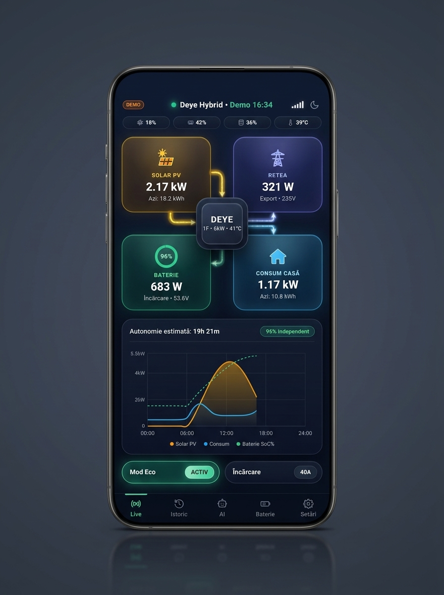

# Deye Smart Energy — ESP32-S3 Local Monitor

Aplicație standalone de monitorizare și automatizare locală pentru invertoare hibride **Deye (Monofazat `1F` & Trifazat `3F`)** pe **ESP32-S3 DevKitC-1 N16R8** (`http://deye.local/`), construită cu o interfață OLED Dark optimizată pentru smartphone, fără dependență de cloud.



---

## 1. Funcționalități Principale

- **Interfață Smartphone OLED Dark (`http://deye.local/`)**:
  - Bară de stare compactă (`Deye Hybrid • Online`, semnal Wi-Fi, buton **Ecran activ** cu Wake Lock, plus 4 iconițe hardware: `CPU%`, `RAM%`, `STOC OTA%`, `TEMP ESP32`).
  - Diagramă **Flux Energetic 2×2** în timp real cu casete tip sticlă iluminată (`SOLAR PV`, `REȚEA`, `BATERIE`, `CONSUM CASĂ`), invertor central **`DEYE`** (`1F/3F • kW • °C`) și canale neon cu puncte luminoase discrete.
  - **Ecrane detaliate la atingere** pentru fiecare nod:
    - **`DEYE`** → *Detalii Invertor Deye* (Stare, Temperatură invertor, Tip & Faze, Putere nominală `kW`, Serie invertor Modbus, Serie & MAC Logger, Factor putere / Frecvență + metrici ESP32-S3).
    - **`SOLAR PV`** → Putere totală, producție azi/total, `MPPT 1`, `MPPT 2`, `MPPT 3`, `MPPT 4`.
    - **`REȚEA`** → Putere totală, Frecvență, Faze `L1/L2/L3`, Import/Export azi, Pene rețea (`7z/14z/30z`) + card **Alerte Inteligente Telegram** (*Alertă Pană de Rețea*).
    - **`BATERIE`** → SoC, SOH, Tensiune/Curent, Temperatură BMS, Limită max / Curent normal, Capacitate pachet (kWh) + **Pauză Încărcare Ziua (Mod Vară 0A)** + **Protecție Îngheț**.
    - **`CONSUM CASĂ`** → Consum instant, sursă activă, consum azi, vârf / medie orară.
  - **Grafic zilnic fix `00:00 – 24:00`** cu axă verticală dinamică în `kW` (trepte de `1 kW` sub `4 kW`, apoi din `2 kW` în `2 kW` pe măsură ce puterea crește) și **Istoric & Randament** pe `Zi / Lună / An / Total` salvat local în SPIFFS.
  - **Mod Demo virtual (24h în 2 minute)** în tab-ul Setări pentru testare completă fără invertor conectat (izolat complet de istoricul real din SPIFFS).
  - **Stare Offline corectă:** când invertorul este deconectat, `SoC`, tensiunile, frecvența și temperaturile nedefinite afișează `--` (`--%`, `--V`, `--°C`), păstrând intacte istoricul SPIFFS și setările din NVS.
- **Asistentul AI Solar „Argus” (Google Gemini + Open-Meteo):**
  - Tab dedicat **AI** cu 6 întrebări rapide predefinite (*Stare sistem acum*, *Autonomie la noapte*, *Analiză producție azi*, *Audit tensiune & setări*, *Estimare producție 7 zile*, *Prognoză meteo 7 zile*) și chat liber.
  - Funcție strict **READ-ONLY** (doar citește, interpretează și explică — nu modifică niciodată setări în invertor), cu buton roșu **Stop** pentru anulare instantanee și buton **Retrimite** la erori.
  - **Trimite Audit pe Telegram:** generează și trimite pe Telegram raportul complet de energie, sănătate baterie (inclusiv starea reală *Mod Vară* din NVS), calitate rețea `EN 50549-1` și recomandări.
  - **Modele Gemini Free Tier:** `Gemini Flash-Lite Latest` (implicit, auto-actualizat), `Gemini 3.8 Flash`, `Gemini 4 Hydrogen` (plus model manual), cu `thinkingLevel: "medium"`, fallback automat și auto-discovery; cheia API este salvată în NVS și afișată mascat în Setări.
  - **Open-Meteo & Auto-calibrare pe 15 zile:** preia prognoza meteo pe 7 zile (fără cheie API, cache 30 min în PSRAM) și corelează producția reală din ultimele până la 15 zile din istoric cu radiația solară și tipul vremii (*Senin / Parțial noros / Înnorat*) pentru estimări pe 7 zile din ce în ce mai precise.
- **Descoperire Solarman Multi-Invertor & Configurare Manuală:**
  - Scanare LAN (`UDP 48899` + verificare `TCP 8899`) cu listă multi-invertor și marcaj `● ACTIV`, plus posibilitate de introducere manuală `IP` și `SN`.
- **Mod Eco Inteligent (Wi-Fi + CPU)**:
  - **Normal**: `WIFI_PS_NONE`, `20 dBm` TX, `CPU 240 MHz`.
  - **Mod Eco**: `WIFI_PS_MIN_MODEM`, TX adaptiv (`8.5–20 dBm`) și scalare dinamică CPU (`80–160 MHz`).
- **Securitate & OTA**:
  - Protecție cu **PIN Administrator** la intrarea în tab-ul **Setări** (sesiune activă după deblocare, protecție anti brute-force).
  - **Dual-OTA cu Rollback Automat** și **bară de progres live `0–100%`** atât la încărcarea locală `.bin`, cât și la actualizarea din **GitHub Releases**, cu revenire automată în Dashboard după 4 secunde.

---

## 2. Cerințe Hardware & Software

### Hardware necesar
1. **Placă ESP32-S3 DevKitC-1 N16R8** (16 MB Flash, 8 MB Octal PSRAM).
2. **Cablu USB-C de date** conectat la portul **UART** (recomandat pentru Windows) sau **USB** al plăcii.
   - *Notă drivere:* pentru portul UART (CH343 / CP2102), asigură-te că driverul USB-Serial este instalat în Windows Device Manager.
3. **Invertor hibrid Deye** cu **stick Wi-Fi Solarman** conectat în aceeași rețea Wi-Fi locală (2.4 GHz), accesibil pe `UDP 48899` și `TCP 8899`.

### Software necesar pe PC (Windows)
- **Varianta rapidă (fără compilare — recomandată):**
  - Doar **Python 3** ([python.org/downloads](https://www.python.org/downloads/)).
  - **Important la instalare:** bifează căsuța **`Add python.exe to PATH`**.
  - Scriptul `flash_esp32_s3.bat` instalează automat `esptool` dacă nu este deja prezent.
- **Varianta avansată (doar dacă modifici codul C și recompilezi):**
  - **ESP-IDF v6.1** instalat în `C:\esp\v6.1\esp-idf` (cu profilul `C:\Espressif\tools\Microsoft.v6.1.PowerShell_profile.ps1`).

---

## 3. Încărcarea Firmware-ului pe ESP32-S3 (USB)

### Metoda A — Instalare rapidă cu `flash_esp32_s3.bat` (Recomandată)
1. Clonează sau descarcă proiectul (fișierul `build/deye_esp32_s3_bridge.bin` este inclus; alternativ, poți descărca `deye_esp32_s3_bridge_v1.0.0.bin` din [Releases](https://github.com/petruleonard/deye-smart-energy/releases) și să-l pui în `build/` sau lângă `.bat`).
2. Conectează placa **ESP32-S3** la PC prin cablul USB-C.
3. Dă dublu-click pe **`flash_esp32_s3.bat`**.
4. Scriptul detectează automat porturile `COM` disponibile și propune portul plăcii (ex. `COM7`). Apasă **`Enter`** pentru portul propus sau tastează numărul portului din Device Manager.
5. Scriptul scrie automat:
   - `build\bootloader\bootloader.bin` la `0x0`
   - `build\partition_table\partition-table.bin` la `0x8000`
   - `build\ota_data_initial.bin` la `0xf000`
   - Firmware-ul în ambele sloturi: `ota_0` (`0x20000`) și `ota_1` (`0x320000`) pentru Dual-OTA Rollback.
6. *Dacă scrierea nu pornește automat:* ține apăsat butonul **`BOOT`** de pe placă, apasă scurt **`RST`**, apoi eliberează **`BOOT`**.

### Metoda B — Compilare din surse (ESP-IDF v6.1)
Deoarece calea folderului conține spații, compilează folosind un director de build extern (`-B C:\esp_build_deye_smart`):

```powershell
. "C:\Espressif\tools\Microsoft.v6.1.PowerShell_profile.ps1"
Set-Location "c:\Users\Leonard\Desktop\Proiect Deye\Deye Smart Energy"
idf.py -B C:\esp_build_deye_smart build
Copy-Item "C:\esp_build_deye_smart\deye_esp32_s3_bridge.bin" "build\deye_esp32_s3_bridge.bin" -Force
```

---

## 4. Prima Pornire & Configurare Wi-Fi (Portal Captiv)

1. După scriere, ESP32-S3 pornește automat hotspotul Wi-Fi **`Deye-ESP32-Setup`** (rețea deschisă).
2. Conectează-te cu telefonul la **`Deye-ESP32-Setup`**. Se va deschide automat portalul captiv (dacă nu se deschide, accesează **`http://192.168.4.1`**).
3. Apasă **Scanează Rețele Wi-Fi**, selectează rețeaua ta **Wi-Fi 2.4 GHz**, introdu parola Wi-Fi și (opțional, dar recomandat) un **Cod PIN Administrator** pentru protejarea Setărilor.
4. Apasă **Conectează & Salvează Wi-Fi**. Placa verifică conexiunea, închide hotspotul și te redirecționează către **`http://deye.local/`**.

> **Redeschidere portal Wi-Fi ulterior:**
> - Din aplicație: **Setări → Configurare Wi-Fi (Portal Captiv `/setup`)** (cu buton roșu **Close** sau swipe pentru ieșire), **sau**
> - Fizic de pe placă: ține apăsat butonul **`BOOT` (GPIO 0)** timp de **3 secunde** pentru a redeschide hotspotul `Deye-ESP32-Setup`.

---

## 5. Parametrizarea Completă a Aplicației

### A. Conectare la Invertor & Sistem (Tab **Setări**)
1. Deschide **`http://deye.local/`** pe telefon (reconectat la Wi-Fi-ul casei).
2. Apasă pe tab-ul **Setări** (dacă ai setat PIN, îl vei introduce o singură dată la intrarea în Setări).
3. Apasă **Scanează Invertor Solarman (LAN)** → selectează loggerul găsit (se completează automat `IP`, `SN` și `MAC`).
4. Setează **Interval Citire Invertor** (`5–60` secunde; recomandat `5s`).
5. Alege modul de alimentare (**Normal 240 MHz** sau **Mod Eco 160 MHz + Modem Sleep**).
6. Apasă **Salvează**.

### B. Alerte Telegram (Tab **Setări** + **Baterie** + **Rețea**)
1. Creează un bot pe Telegram cu **`@BotFather`** (`/newbot`) pentru a obține **Bot Token**.
2. Află **Chat ID**-ul tău de la **`@userinfobot`**.
3. Introdu **Telegram Bot Token** și **Telegram Chat ID** în tab-ul **Setări**, apasă **Salvează**, apoi verifică cu **Test Telegram**.
4. Activează alertele dorite:
   - În **Baterie**: *Alertă Lipsă Comunicație BMS*, *Protecție Îngheț Baterie* (+ prag °C).
   - În **Detalii Rețea & Faze** (click pe caseta **`REȚEA`**): *Alertă Pană de Rețea*.

### C. Automatizări Baterie & Autonomie (Tab **Baterie**)
- Setează **Capacitatea pachetului de baterii (kWh)** pentru calculul precis al **Autonomiei estimate**.
- Opțional, activează **Pauză Încărcare Ziua (Mod Vară 0A)** și alege intervalul orar (ex. `06:00 – 11:00`) — placa setează automat curentul de încărcare la `0A` în acel interval și îl restaurează la curentul normal salvat după încheierea ferestrei.

### D. Asistent AI Argus & Open-Meteo (Tab **Setări** + **AI**)
1. Obține o cheie API gratuită din **Google AI Studio**, introdu-o în tab-ul **Setări** → **Cheie API Gemini**, alege modelul dorit (implicit **`Gemini Flash-Lite Latest`**, auto-actualizat) și apasă **Salvează**.
2. În **Localitate Meteo (Open-Meteo)**, scrie orașul și apasă **Caută** (sau **📍 Auto**), apoi apasă **Salvează** pentru a activa prognoza meteo și estimarea de producție pe 7 zile.
3. Deschide tab-ul **AI** pentru a discuta cu **Argus** sau pentru a trimite un **Audit AI Solar pe Telegram**.

### E. Actualizări Firmware OTA (Tab **Setări**)
- **Din GitHub:** apasă **Verifică GitHub** → dacă există o versiune nouă, apasă **Instalează Actualizarea GitHub**.
- **Local din fișier `.bin`:** selectează fișierul `.bin` și apasă **Instalează .bin** (progres live `0–100%` și revenire automată în Dashboard după 4 secunde).
- Dacă un firmware nou nu se poate conecta la Wi-Fi în 45s, ESP32-S3 revine automat la versiunea anterioară (**Dual-OTA Rollback**).

### F. Instalare ca Aplicație PWA pe Telefon / Desktop (Opțional)
Aplicația include `manifest.json`, Service Worker (`/sw.js`) și iconițe dedicate. Pentru a o instala pe ecran complet (fără bara de adresă Chrome) pe o rețea locală HTTP:
1. Deschide `chrome://flags` în Chrome (Android sau PC).
2. Caută **`Insecure origins treated as secure`**.
3. Introdu `http://deye.local` (sau IP-ul local al plăcuței, separate prin virgulă fără spații).
4. Setează flag-ul pe **Enabled** și repornește browserul.
5. Deschide `http://deye.local/` → meniu Chrome → **Install app / Add to Home screen** (deblochează și GPS-ul browserului pentru locația meteo).
